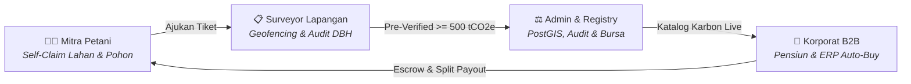

# 🌿 TaniKarbon — Platform MRV Agroforestri & Bursa Karbon Berbasis AI

[](https://react.dev/)
[](https://vitejs.dev/)
[](https://tailwindcss.com/)
[](https://leafletjs.com/)
[](https://sentinels.copernicus.eu/)
[](https://srn.menlhk.go.id/)
[](https://www.ojk.go.id/)

> **TaniKarbon** adalah platform MRV (*Measurement, Reporting, Verification*) karbon berbasis kecerdasan buatan, citra satelit multispektral (ESA Sentinel-2), dan spasial PostGIS yang menghubungkan kelompok tani agroforestri rakyat Indonesia dengan pembeli kredit karbon korporat institusional melalui transparansi split-payout matematis serta audit berjenjang.

---

## 🏛️ Arsitektur 4 Pilar Peran (End-to-End Ecosystem)

TaniKarbon mengintegrasikan 4 peran kunci dalam satu siklus hidup kredit karbon:



| Role / Entitas | Akses Route | Fokus & Tanggung Jawab Utama |
|---|---|---|
| **1. Beranda Publik & Edukasi** | `/` | Narasi edukasi transparansi karbon, kalkulator alometrik Chave Tier-3, dan peta satelit 3D. |
| **2. Gateway Autentikasi** | `/login` | Gerbang masuk glassmorphism dengan role switch instan untuk demo penjurian 4 peran. |
| **3. Mitra Tani (AgroPulse)** | `/mitra-tani` | Paspor pohon digital, pendaftaran petak GPS, pemantauan dividen, dan penarikan dana tunai (BRI / DANA). |
| **4. Surveyor Lapangan (Field Verifier)** | `/surveyor` | Inspeksi geofencing $\le 50\text{m}$, rekonsiliasi DBH & alometrik, mode offline PWA, dan resertifikasi tahunan. |
| **5. Pembeli Korporat (B2B ESG Portal)** | `/korporat` | Neraca emisi Scope 1-3, bursa karbon per klaster, pre-funded deposit, integrasi ERP Auto-Buy, dan sertifikat pensiun. |
| **6. Admin Platform (System Manager & Registry Authority)** | `/admin` | Executive Command Center, klasterisasi PostGIS 10 km, pengesahan audit eksternal, brankas escrow & split-payout, master alometrik, dan monitor API. |

---

## 🚀 Fitur Unggulan per Peran

### 1. 👨‍🌾 Role Mitra Tani (`/mitra-tani`)
* **Bahasa Desain AgroPulse**: Mobile-friendly, hangat, dan ramah bagi petani pedesaan dengan Bottom Navigation Bar melayang.
* **Paspor Pohon Digital**: Verifikasi biometrik lingkar batang (DBH), biomassa kering, dan serapan $\text{CO}_2$ dengan akreditasi SRN-PPI KLHK.
* **Foto Botani Asli & Viewfinder Watermark**: Unggah sampel pohon ber-watermark GPS dan kompas waktu nyata.
* **Peta Ortofoto Satelit & Kadaster**: Visualisasi koordinat lahan poligon dengan indikasi NDVI klorofil.
* **Pencairan Saldo Instan**: Dompet bagi hasil panen karbon dengan transfer rekening bank (BRI) dan e-Wallet (GoPay/DANA).

### 2. 📋 Role Petugas / Surveyor Lapangan (`/surveyor`)
* **Geofencing GPS Anti-Fiktif ($\le 50\text{ meter}$)**: Tombol *Check-In Lokasi* hanya aktif jika petugas berada di dalam poligon kebun petani.
* **Audit Komparasi Berdampingan (Side-by-Side Reconciliation)**: Membandingkan klaim awal petani dengan temuan aktual petugas beserta kalkulasi ulang instan.
* **Detektor Deviasi Ekstrem ($> 15\%$)**: Peringatan otomatis jika lingkar batang menyimpang signifikan untuk mencegah kecurangan.
* **Mode Offline & Antrean Sinkronisasi (PWA Ready)**: Tetap dapat melakukan pengukuran di pedalaman tanpa sinyal internet, data tersimpan di IndexedDB dan tersinkronisasi otomatis saat terhubung kembali.
* **Inspeksi Ulang Tahunan (Annual Reverification)**: Pemantauan pertumbuhan biomassa tahun kedua (*Vintage Renewal*).

### 3. 🏢 Role Korporat / B2B ESG Portal (`/korporat`)
* **Light Nordic Enterprise Dashboard**: Antarmuka berwibawa standar Stripe/Linear untuk jajaran CFO dan direksi ESG.
* **Katalog Karbon Terkurasi per Klaster**: Beli kredit karbon lengkap dengan profil dampak sosial, lokasi geospasial, dan nomor registri KLHK.
* **Buku Besar Sertifikat Pensiun (RETIRED)**: Cetak dokumen Berita Acara Pensiun (BAP) ber-QR Code publik untuk kepatuhan OJK POJK 51/2017.
* **Integrasi Otomatis ERP (SAP / NetSuite / Odoo)**: Endpoint REST API & Webhook (`POST /api/v1/offset/auto-buy`) untuk otomatisasi offset emisi kargo dan pabrik secara *real-time*.
* **Brankas Saldo Pre-Funded**: Deposit fleksibel via Virtual Account Mandiri/BCA dengan faktur pajak instan.

### 4. ⚖️ Role Admin Platform & Registry Authority (`/admin`)
* **Executive Command Center**: Grid metrik pasokan karbon nasional (Pipeline $10.790\text{ tCO}_2\text{e}$), kesehatan kas (GMV Rp 819.2M), peta geospasial Leaflet, dan antrean tindakan mendesak.
* **Manajemen Klaster & GIS PostGIS**: Visualisasi lingkaran radius 10 km (`ST_DWithin` & `ST_Centroid`), rincian poligon lahan petani, dan editor profil dampak sosial desa.
* **Validasi Audit Eksternal & Penerbitan Bursa**: Bundel data auditor (`.ZIP / GeoJSON / CSV`), modal pengesahan laporan audit (PT Sucofindo / Mutuagung Lestari), pencatatan talangan audit (*Cost Recovery*), dan aktivasi stepper petani ke Tahap 4 (Verified).
* **Brankas Keuangan, Escrow & Split-Payout**: Mesin transparansi pembagian dana matematis:
  $$\text{Net Payout Pool} = \text{Gross Revenue} - \text{Cost Recovery} - \text{Platform Fee 15\%}$$
  $$\text{Payout Petani}_i = \text{Net Payout Pool} \times \left(\frac{\text{Tonase}_i}{\text{Total Tonase Klaster}}\right)$$
  Verifikasi pencairan petani dengan unggah struk bank, serta verifikasi top-up deposit B2B korporat.
* **Master Parameter & Rumus Alometrik**: CRUD biometrik spesies pohon ($AGB = a \times D^b$, fraksi karbon $44/12 \approx 3,67$), kontrol harga bursa (IDXCarbon + premi sosial), dan konfigurasi toleransi geofencing.
* **Registri Sertifikat & Monitor API**: Buku besar permanen seluruh sertifikat pensiun publik, monitor log API *real-time* (latency 24ms), dan tombol simulasi *Test Webhook ERP*.
* **Manajemen Pengguna & Wilayah Surveyor**: Penugasan spasial akun surveyor ke klaster tertentu, log kepatuhan geofencing ($98.5\%$), dan direktori KYB korporat.

---

## 📁 Struktur Direktori Proyek

```text
TaniKarbon/
├── public/                                # Aset fotografi kanopi, tanah, & sampel DBH
│   ├── favicon.svg                        # Logo resmi TaniKarbon
│   ├── auth-bg.jpg                        # Latar belakang Gunung Sindoro
│   ├── canopy-tree.jpg                    # Tajuk pohon ortofoto
│   ├── tree-dbh-sample.jpg                # Pita ukur lingkar batang surveyor
│   └── pak-joko.jpg                       # Foto profil mitra tani binaan
├── src/
│   ├── components/
│   │   ├── admin/                         # Modul Role Admin Platform (Registry Authority)
│   │   │   ├── AdminDashboardView.jsx     # Halaman 1: Executive Command Center & Peta Nasional
│   │   │   ├── AdminSidebar.jsx           # Fixed Left Sidebar (Desktop-First, No URL text)
│   │   │   ├── AdminTopBar.jsx            # TopBar Indikator PostGIS, SRN-PPI & Role Switcher
│   │   │   ├── AuditApprovalAndMintingModal.jsx # Modal Pengesahan Audit & Terbit Bursa
│   │   │   ├── ClusterGeoManagementView.jsx # Halaman 2: PostGIS Cluster & Polygon Canvas
│   │   │   ├── ClusterNameEditorModal.jsx # Editor Nama Geocoding & Narasi Dampak Desa
│   │   │   ├── ExternalAuditAndMintingView.jsx # Halaman 3: Validasi Audit & Renewal Vintage
│   │   │   ├── FinancialEscrowAndPayoutView.jsx # Halaman 4: Split-Payout & Rekonsiliasi Kas
│   │   │   ├── RegistryAndApiMonitorView.jsx # Halaman 6: Buku Besar Sertifikat & Log API
│   │   │   ├── SystemParametersMasterView.jsx # Halaman 5: Master Alometrik CRUD & Harga
│   │   │   ├── UploadTransferProofModal.jsx # Modal Unggah Struk Bukti Transfer Payout
│   │   │   └── UserAndSurveyorManagementView.jsx # Halaman 7: Penugasan Surveyor & KYB
│   │   ├── corporate/                     # Modul Role Korporat / B2B ESG Buyer
│   │   │   ├── CarbonCheckoutModal.jsx    # Modal Pembelian Karbon Klaster
│   │   │   ├── CarbonMarketplaceView.jsx  # Katalog Bursa Karbon Terverifikasi
│   │   │   ├── CertificatePreviewModal.jsx # Modal Pratinjau Sertifikat QR Code
│   │   │   ├── CertificateRegistryView.jsx # Portofolio Sertifikat Pensiun (RETIRED)
│   │   │   ├── ClusterDetailDrawer.jsx    # Drawer Detail Spasial & Bukti Lapangan
│   │   │   ├── CompanyDashboardView.jsx   # Dasbor Neraca Emisi Scope 1-3 & ESG
│   │   │   ├── CorporateSidebar.jsx       # Sidebar Desktop Linear/Stripe Style
│   │   │   ├── CorporateTopBar.jsx        # TopBar Profil PT & Role Switcher
│   │   │   ├── CorporateWalletView.jsx    # Brankas Deposit & Riwayat Transaksi
│   │   │   ├── ErpIntegrationView.jsx     # Dokumentasi REST API, API Key & Webhook
│   │   │   └── TopUpDepositModal.jsx      # Modal Isi Deposit Korporat VA
│   │   ├── farmer/                        # Modul Role Mitra Petani (AgroPulse)
│   │   │   ├── FarmerDashboardView.jsx    # Dasbor Dividen & Ringkasan Pohon
│   │   │   ├── FarmerMobileNav.jsx        # Floating Bottom Bar untuk Layar HP
│   │   │   ├── FarmerSidebar.jsx          # Sidebar Desktop Profil Petani
│   │   │   ├── FarmerTopBar.jsx           # TopBar Sinkronisasi & Switcher
│   │   │   ├── FarmerWalletView.jsx       # Dompet Bagi Hasil & Accordion Transparansi
│   │   │   ├── LandManagementView.jsx     # Manajemen Petak Lahan & Peta Ortofoto
│   │   │   ├── LandRegistrationWizard.jsx # Form 3 Langkah Pendaftaran Petak Baru
│   │   │   ├── SamplePhotoModal.jsx       # Pratinjau Foto Pohon & Metadata Satelit
│   │   │   ├── TransferReceiptModal.jsx   # Modal Struk Bukti Transfer Bank
│   │   │   ├── VerificationTimelineView.jsx # Stepper 4 Tahap Menuju Verifikasi Bursa
│   │   │   ├── ViewfinderModal.jsx        # Kamera Unggah Sampel Ber-Watermark GPS
│   │   │   └── WithdrawalModal.jsx        # Modal Penarikan Saldo Petani (BRI/DANA)
│   │   ├── surveyor/                      # Modul Role Petugas / Surveyor Lapangan
│   │   │   ├── AnnualReverificationView.jsx # Inspeksi Ulang Pertumbuhan Tahunan
│   │   │   ├── FieldInspectionWorksheetView.jsx # Lembar Kerja Ukur DBH & Geofencing
│   │   │   ├── FieldMapNavigationView.jsx # Navigasi Rute GPS ke Kebun Petani
│   │   │   ├── OfflineSyncAndHistoryView.jsx # Antrean Sinkronisasi Offline & Log
│   │   │   ├── ScheduleVisitModal.jsx     # Modal Penjadwalan Survei Lapangan
│   │   │   ├── SurveyorDashboardView.jsx  # Dasbor Kinerja, Kuota & Antrean Tugas
│   │   │   ├── SurveyorMobileNav.jsx      # Bottom Bar Navigasi Mobile Petugas
│   │   │   ├── SurveyorSidebar.jsx        # Sidebar Desktop Surveyor
│   │   │   └── SurveyorTopBar.jsx         # Indikator Online/Offline & Switcher
│   │   ├── AdminWorkspace.jsx             # Orkestrator Seluruh Modul Admin
│   │   ├── AuthGateway.jsx                # Pintu Masuk Autentikasi Glassmorphism
│   │   ├── CorporateMarketplace.jsx       # Orkestrator Portal Korporat
│   │   ├── FarmerWorkspace.jsx            # Orkestrator Portal Mitra Tani
│   │   ├── LandingPage.jsx                # Halaman Beranda Naratif Publik
│   │   ├── Satellite3DMap.jsx             # Peta Satelit Interaktif Leaflet
│   │   └── SurveyorWorkspace.jsx          # Orkestrator Portal Surveyor
│   ├── App.jsx                            # Router URL & Manajemen State Global
│   ├── data.js                            # Dataset Master Alometrik, Pohon & Klaster
│   ├── index.css                          # Desain Sistem Tailwind & Font
│   └── main.jsx                           # Entry Point React DOM
├── index.html                             # Template HTML dengan Google Fonts
├── package.json                           # Dependensi & Skrip Proyek
├── tailwind.config.js                     # Token Palet Warna Deep Pine & Emerald
└── vite.config.js                         # Bundler Konfigurasi Vite
```

---

## 🛠️ Tech Stack

* **Frontend Framework**: [React 19](https://react.dev/)
* **Build Tool**: [Vite 6](https://vitejs.dev/)
* **Styling**: [TailwindCSS 3](https://tailwindcss.com/)
* **Typography**: Plus Jakarta Sans / Inter (UI Sans-Serif) & JetBrains Mono (Metrik Numerik & Formula)
* **Icons**: [Lucide React](https://lucide.dev/)
* **Peta Spasial & Geofencing**: [Leaflet](https://leafletjs.com/) dengan tile satelit ArcGIS World Imagery & OpenStreetMap
* **Arsitektur Spasial**: Mocking PostGIS (`ST_Centroid`, `ST_DWithin`, `ST_Contains`)

---

## 💻 Menjalankan Proyek Secara Lokal

1. **Clone repository:**
   ```bash
   git clone https://github.com/ArdisID/TaniKarbon.git
   cd TaniKarbon
   ```

2. **Install dependensi:**
   ```bash
   npm install
   ```

3. **Jalankan development server:**
   ```bash
   npm run dev
   ```
   Aplikasi akan berjalan di `http://localhost:5173` atau `http://localhost:5174`.

4. **Navigasi Cepat Antar Portal (URL):**
   * Beranda Publik: `http://localhost:5173/`
   * Autentikasi & Quick Demo: `http://localhost:5173/login`
   * Portal Mitra Tani: `http://localhost:5173/mitra-tani`
   * Portal Surveyor Lapangan: `http://localhost:5173/surveyor`
   * Portal Korporat B2B: `http://localhost:5173/korporat`
   * Portal Admin & Otoritas Registri: `http://localhost:5173/admin`

5. **Build untuk Produksi:**
   ```bash
   npm run build
   ```

---

## 📜 Kepatuhan & Regulasi

Platform TaniKarbon dirancang agar selaras dengan kerangka regulasi keberlanjutan Republik Indonesia dan standar internasional:
* **Peraturan Menteri LHK No. 21/2022**: Tata Laksana Penerapan Nilai Ekonomi Karbon (NEK) dan Sistem Registri Nasional (SRN-PPI).
* **Peraturan OJK No. 51/POJK.03/2017**: Penerapan Keuangan Berkelanjutan bagi Lembaga Jasa Keuangan, Emiten, dan Perusahaan Publik.
* **Metodologi MRV**: Persamaan Alometrik Chave et al. (2014) Tier-3, ISO 14064-2, dan Verra VM0042.

---

**© 2026 PT TaniKarbon Solusi Nusantara. All rights reserved.**
