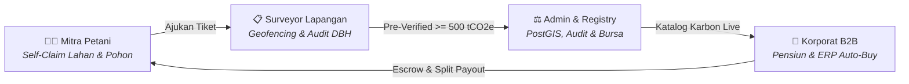

# 🌿 TaniKarbon — Platform MRV Agroforestri & Bursa Karbon Berbasis AI

[](https://react.dev/)
[](https://fastapi.tiangolo.com/)
[](https://www.python.org/)
[](https://postgis.net/)
[](https://vitejs.dev/)
[](https://tailwindcss.com/)
[](https://leafletjs.com/)
[](https://sentinels.copernicus.eu/)
[](https://srn.menlhk.go.id/)
[](https://www.ojk.go.id/)

> **TaniKarbon** adalah platform MRV (*Measurement, Reporting, Verification*) karbon berbasis kecerdasan buatan, citra satelit multispektral (ESA Sentinel-2), dan spasial PostGIS yang menghubungkan kelompok tani agroforestri rakyat Indonesia dengan pembeli kredit karbon korporat institusional melalui transparansi split-payout matematis serta audit berjenjang.

---

## 🏛️ Arsitektur 4 Pilar Peran (End-to-End Ecosystem)

TaniKarbon mengintegrasikan 4 peran kunci dalam satu siklus hidup kredit karbon:



| Role / Entitas | Akses Route | Fokus & Tanggung Jawab Utama |
|---|---|---|
| **1. Beranda Publik & Edukasi** | `/` | Narasi edukasi transparansi karbon, kalkulator alometrik Chave Tier-3, dan peta satelit 3D. |
| **2. Gateway Autentikasi Publik** | `/login` | Gerbang masuk publik 2 tab bersih: Mitra Tani (No. HP/WA) & Perusahaan ESG (Work Email). |
| **3. Login Khusus Staff Surveyor** | `/surveyor/login` | Tampilan mobile-first field petugas dengan ID Surveyor & PIN Keamanan. |
| **4. Login Khusus Admin Otoritas** | `/admin/login` | Command center gelap/deep pine dengan Admin Identifier & Master Key. |
| **5. Mitra Tani (AgroPulse)** | `/mitra-tani` | Paspor pohon digital, pendaftaran petak GPS, pemantauan dividen, dan penarikan dana tunai (BRI / DANA). |
| **6. Surveyor Lapangan (Field Verifier)** | `/surveyor` | Inspeksi geofencing $\le 50\text{m}$, rekonsiliasi DBH & alometrik, mode offline PWA, dan resertifikasi tahunan. |
| **7. Pembeli Korporat (B2B ESG Portal)** | `/korporat` | Neraca emisi Scope 1-3, bursa karbon per klaster, pre-funded deposit, integrasi ERP Auto-Buy, dan sertifikat pensiun. |
| **8. Admin Platform (System Manager & Registry Authority)** | `/admin` | Executive Command Center, klasterisasi PostGIS 10 km, pengesahan audit eksternal, brankas escrow & split-payout, master alometrik, dan monitor API. |

---

## 🚀 Fitur Unggulan per Peran

### 1. 👨‍🌾 Role Mitra Tani (`/mitra-tani`)
* **Bahasa Desain AgroPulse**: Mobile-friendly, hangat, dan ramah bagi petani pedesaan dengan Bottom Navigation Bar melayang.
* **Paspor Pohon Digital**: Verifikasi biometrik lingkar batang (DBH), biomassa kering, dan serapan $\text{CO}_2$ dengan akreditasi SRN-PPI KLHK.
* **Foto Botani Asli & Viewfinder Watermark**: Unggah sampel pohon ber-watermark GPS dan kompas waktu nyata.
* **Peta Ortofoto Satelit & Kadaster**: Visualisasi koordinat lahan poligon dengan indikasi NDVI klorofil.
* **Pencairan Saldo Instan**: Dompet bagi hasil panen karbon dengan transfer rekening bank (BRI) dan e-Wallet (GoPay/DANA).

### 2. 📋 Role Petugas / Surveyor Lapangan (`/surveyor`)
* **Geofencing GPS Anti-Fiktif ($\le 50\text{ meter}$)**: Tombol *Check-In Lokasi* hanya aktif jika petugas berada di dalam poligon kebun petani.
* **Audit Komparasi Berdampingan (Side-by-Side Reconciliation)**: Membandingkan klaim awal petani dengan temuan aktual petugas beserta kalkulasi ulang instan.
* **Detektor Deviasi Ekstrem ($> 15\%$)**: Peringatan otomatis jika lingkar batang menyimpang signifikan untuk mencegah kecurangan.
* **Mode Offline & Antrean Sinkronisasi (PWA Ready)**: Tetap dapat melakukan pengukuran di pedalaman tanpa sinyal internet, data tersimpan di IndexedDB dan tersinkronisasi otomatis saat terhubung kembali.
* **Inspeksi Ulang Tahunan (Annual Reverification)**: Pemantauan pertumbuhan biomassa tahun kedua (*Vintage Renewal*).

### 3. 🏢 Role Korporat / B2B ESG Portal (`/korporat`)
* **Light Nordic Enterprise Dashboard**: Antarmuka berwibawa standar Stripe/Linear untuk jajaran CFO dan direksi ESG.
* **Katalog Karbon Terkurasi per Klaster**: Beli kredit karbon lengkap dengan profil dampak sosial, lokasi geospasial, dan nomor registri KLHK.
* **Buku Besar Sertifikat Pensiun (RETIRED)**: Cetak dokumen Berita Acara Pensiun (BAP) ber-QR Code publik untuk kepatuhan OJK POJK 51/2017.
* **Integrasi Otomatis ERP (SAP / NetSuite / Odoo)**: Endpoint REST API & Webhook (`POST /api/v1/offset/auto-buy`) untuk otomatisasi offset emisi kargo dan pabrik secara *real-time*.
* **Brankas Saldo Pre-Funded**: Deposit fleksibel via Virtual Account Mandiri/BCA dengan faktur pajak instan.

### 4. ⚖️ Role Admin Platform & Registry Authority (`/admin`)
* **Executive Command Center**: Grid metrik pasokan karbon nasional (Pipeline $10.790\text{ tCO}_2\text{e}$), kesehatan kas (GMV Rp 819.2M), peta geospasial Leaflet, dan antrean tindakan mendesak.
* **Manajemen Klaster & GIS PostGIS**: Visualisasi lingkaran radius 10 km (`ST_DWithin` & `ST_Centroid`), rincian poligon lahan petani, dan editor profil dampak sosial desa.
* **Validasi Audit Eksternal & Penerbitan Bursa**: Bundel data auditor (`.ZIP / GeoJSON / CSV`), modal pengesahan laporan audit (PT Sucofindo / Mutuagung Lestari), pencatatan talangan audit (*Cost Recovery*), dan aktivasi stepper petani ke Tahap 4 (Verified).
* **Brankas Keuangan, Escrow & Split-Payout**: Mesin transparansi pembagian dana matematis:
  $$\text{Net Payout Pool} = \text{Gross Revenue} - \text{Cost Recovery} - \text{Platform Fee 15\%}$$
  $$\text{Payout Petani}_i = \text{Net Payout Pool} \times \left(\frac{\text{Tonase}_i}{\text{Total Tonase Klaster}}\right)$$
  Verifikasi pencairan petani dengan unggah struk bank, serta verifikasi top-up deposit B2B korporat.
* **Master Parameter & Rumus Alometrik**: CRUD biometrik spesies pohon ($AGB = a \times D^b$, fraksi karbon $44/12 \approx 3,67$), kontrol harga bursa (IDXCarbon + premi sosial), dan konfigurasi toleransi geofencing.
* **Registri Sertifikat & Monitor API**: Buku besar permanen seluruh sertifikat pensiun publik, monitor log API *real-time* (latency 24ms), dan tombol simulasi *Test Webhook ERP*.
* **Manajemen Pengguna & Wilayah Surveyor**: Penugasan spasial akun surveyor ke klaster tertentu, log kepatuhan geofencing ($98.5\%$), dan direktori KYB korporat.

---

## 📁 Struktur Direktori Proyek

```text
TaniKarbon/
├── .gitattributes                             # Konfigurasi penanganan atribut & line-ending Git
├── .gitignore                                # Pola pengabaian berkas sementara, cache, dan node_modules
├── package.json                              # Skrip monorepo root untuk orkestrasi npm dev/build
├── README.md                                 # Dokumentasi komprehensif arsitektur, berkas, & panduan proyek
├── backend/                                  # Layanan Backend REST API & Engine Spasial (FastAPI + PostGIS)
│   ├── database.py                           # Konfigurasi koneksi asynchronous PostgreSQL (asyncpg + SQLAlchemy)
│   ├── main.py                               # Entry point FastAPI, routing endpoint bisnis, & kalkulasi alometrik
│   ├── models.py                             # Skema model tabel database relasional & relasi ORM SQLAlchemy
│   └── schemas.py                            # Definisi skema kontrak data request/response berbasis Pydantic v2
└── Frontend/                                 # Aplikasi Web Klien Terintegrasi (React 18 + Vite 6 + TailwindCSS)
    ├── index.html                            # Dokumen HTML utama & pemuatan web fonts Google
    ├── package.json                          # Dependensi frontend & script task runner
    ├── package-lock.json                     # Snapshot pohon dependensi npm terkunci
    ├── postcss.config.js                     # Konfigurasi engine PostCSS untuk Tailwind & Autoprefixer
    ├── tailwind.config.js                    # Konfigurasi desain sistem warna Deep Pine, Emerald, & typography
    ├── vite.config.js                        # Konfigurasi build bundler Vite dengan plugin React
    ├── public/                               # Direktori aset statis & fotografi botani beresolusi tinggi
    │   ├── agri-drone.jpg                    # Visual pemantauan kebun agroforestri via aerial drone
    │   ├── auth-bg-plantation.jpg            # Latar visual lanskap agroforestri untuk halaman login
    │   ├── auth-bg.jpg                       # Alternatif aset latar belakang autentikasi
    │   ├── canopy-tree.jpg                   # Fotografi ortofoto tutupan tajuk kanopi pohon
    │   ├── favicon.svg                       # Ikon logo vektor resmi TaniKarbon (daun & simbol karbon)
    │   ├── hero-agroforest.jpg               # Gambar utama hero section lanskap agroforestri
    │   ├── hero-landscape.png                # Grafis lanskap topografi interaktif di landing page
    │   ├── pak-joko.jpg                      # Foto profil percontohan mitra petani binaan
    │   └── tree-dbh-sample.jpg               # Dokumentasi pita ukur diameter pohon (DBH) surveyor
    └── src/                                  # Kode sumber aplikasi frontend
        ├── App.jsx                           # Router URL global & sinkronisasi state lintas peran
        ├── data.js                           # Dataset master alometrik, klaster pohon, & simulasi pasar
        ├── index.css                         # Styling global, glassmorphism, animasi pulse, & font rules
        ├── main.jsx                          # Titik masuk eksekusi JavaScript render DOM React 18
        └── components/                       # Modul komponen antarmuka pengguna
            ├── AdminWorkspace.jsx            # Orkestrator utama seluruh view & alur kerja Admin Otoritas
            ├── AuthGateway.jsx               # Pintu masuk login 2 tab (Mitra Tani & Korporat ESG) + demo switch
            ├── CorporateMarketplace.jsx      # Orkestrator portal pembeli B2B korporat ESG
            ├── FarmerWorkspace.jsx           # Orkestrator portal operasional Mitra Petani
            ├── LandingPage.jsx               # Beranda naratif publik, kalkulator Chave Tier-3, & showcase
            ├── Satellite3DMap.jsx            # Komponen peta satelit GIS interaktif Leaflet
            ├── SurveyorWorkspace.jsx         # Orkestrator aplikasi lapangan surveyor verifikator
            ├── admin/                        # Modul Role Admin Platform (Registry Authority)
            │   ├── AdminDashboardView.jsx    # Executive Command Center metrik nasional & antrean kritis
            │   ├── AdminLoginView.jsx        # Halaman autentikasi khusus root admin & master key
            │   ├── AdminSidebar.jsx          # Bilah navigasi samping desktop admin
            │   ├── AdminTopBar.jsx           # Indikator status koneksi PostGIS & sinkronisasi SRN-PPI
            │   ├── AuditApprovalAndMintingModal.jsx # Modal pengesahan audit pihak ketiga & minting kuota bursa
            │   ├── ClusterGeoManagementView.jsx # Manajemen klaster 10 km PostGIS & visualisasi poligon
            │   ├── ClusterNameEditorModal.jsx # Modal pengeditan metadata klaster & narasi dampak sosial
            │   ├── ExternalAuditAndMintingView.jsx # Manajemen audit eksternal, batch minting, & vintage renewal
            │   ├── FinancialEscrowAndPayoutView.jsx # Brankas escrow, formula split-payout, & transfer dana
            │   ├── RegistryAndApiMonitorView.jsx # Buku besar sertifikat pensiun & pemantau latensi API ERP
            │   ├── SystemParametersMasterView.jsx # Master formula alometrik, harga bursa, & toleransi geofencing
            │   ├── UploadTransferProofModal.jsx # Modal unggah bukti struk transfer bagi hasil petani
            │   └── UserAndSurveyorManagementView.jsx # Manajemen pengguna, penugasan surveyor, & KYB B2B
            ├── corporate/                    # Modul Role Korporat / Pembeli B2B ESG
            │   ├── CarbonCheckoutModal.jsx   # Modal transaksi checkout pembelian kredit karbon klaster
            │   ├── CarbonMarketplaceView.jsx # Katalog bursa kredit karbon terverifikasi & filter klaster
            │   ├── CertificatePreviewModal.jsx # Modal pratinjau Berita Acara Pensiun (BAP) & QR Code
            │   ├── CertificateRegistryView.jsx # Portofolio sertifikat pensiun emisi Scope 1-3 korporat
            │   ├── ClusterDetailDrawer.jsx   # Drawer samping rincian mendalam klaster & verifikasi auditor
            │   ├── CompanyDashboardView.jsx  # Dasbor neraca emisi GRK perusahaan & analitik dekarbonisasi
            │   ├── CorporateSidebar.jsx      # Bilah navigasi samping bergaya Nordic Enterprise
            │   ├── CorporateTopBar.jsx       # Bilah atas korporat: saldo deposit pre-funded & profil PT
            │   ├── CorporateWalletView.jsx   # Dompet deposit B2B, riwayat mutasi debit/kredit, & faktur
            │   ├── ErpIntegrationView.jsx    # Dokumentasi REST API Auto-Buy, API Key manager, & webhook
            │   └── TopUpDepositModal.jsx     # Modal pengisian deposit saldo pre-funded via Virtual Account
            ├── farmer/                       # Modul Role Mitra Petani (AgroPulse UI)
            │   ├── FarmerDashboardView.jsx   # Dasbor Bento Soft-Pill estimasi dividen, kuota, & biometrik
            │   ├── FarmerMobileNav.jsx       # Floating bottom navigation bar untuk perangkat mobile petani
            │   ├── FarmerSidebar.jsx         # Bilah navigasi samping desktop petani
            │   ├── FarmerTopBar.jsx          # Bilah status atas: indikator sinkronisasi & profil kebun
            │   ├── FarmerWalletView.jsx      # Dompet bagi hasil panen karbon & riwayat pencairan dana
            │   ├── LandManagementView.jsx    # Manajemen petak kebun, daftar blok pohon, & peta kadaster
            │   ├── LandRegistrationWizard.jsx # Form 3 langkah pendaftaran petak baru & batas koordinat
            │   ├── SamplePhotoModal.jsx      # Pratinjau foto pohon dengan metadata watermark satelit
            │   ├── TransferReceiptModal.jsx  # Modal tanda terima bukti transfer pembayaran dividen
            │   ├── VerificationTimelineView.jsx # Pelacak 4 tahapan verifikasi menuju bursa karbon
            │   ├── ViewfinderModal.jsx       # Kamera simulasi viewfinder dengan watermark GPS & kompas
            │   └── WithdrawalModal.jsx       # Form penarikan saldo dividen petani ke bank (BRI) / e-wallet
            └── surveyor/                     # Modul Role Surveyor & Petugas Lapangan
                ├── AnnualReverificationView.jsx # Inspeksi berkala tahunan pertumbuhan pohon (vintage renewal)
                ├── FieldInspectionWorksheetView.jsx # Lembar kerja ukur DBH lapangan & komparasi rekonsiliasi
                ├── FieldMapNavigationView.jsx # Navigasi GPS rute menuju lokasi kebun petani
                ├── OfflineSyncAndHistoryView.jsx # Antrean sinkronisasi offline (PWA) & log riwayat inspeksi
                ├── ScheduleVisitModal.jsx    # Modal penjadwalan kunjungan audit fisik kebun petani
                ├── SurveyorDashboardView.jsx # Dasbor tugas harian, kuota verifikasi, & kepatuhan geofencing
                ├── SurveyorLoginView.jsx     # Login mobile-first surveyor dengan ID Petugas & PIN keamanan
                ├── SurveyorMobileNav.jsx     # Bilah navigasi bawah praktis untuk petugas di kebun
                ├── SurveyorSidebar.jsx       # Bilah samping desktop surveyor untuk komputer kantor
                └── SurveyorTopBar.jsx        # Bilah status atas dengan indikator Online/Offline real-time
```

---

## 📚 Deskripsi Lengkap & Fungsi Setiap Berkas

Berikut adalah katalog teknis komprehensif yang menjelaskan peran dan fungsi setiap berkas dalam repositori **TaniKarbon**:

### 1. ⚙️ Berkas Root & Monorepo Configuration

| Nama Berkas | Path | Fungsi & Tanggung Jawab Teknis |
|---|---|---|
| `package.json` | `/package.json` | Konfigurasi root monorepo yang mempermudah orkestrasi skrip frontend dari folder utama melalui perintah `npm run dev`, `npm run build`, dan `npm run preview`. |
| `README.md` | `/README.md` | Dokumentasi pusat repositori yang merangkum arsitektur 4 pilar peran, daftar seluruh direktori dan berkas, diagram alur, panduan instalasi lokal, tech stack, dan dasar regulasi hukum. |
| `.gitignore` | `/.gitignore` | Mendefinisikan daftar berkas dan folder yang dikecualikan dari pelacakan version control Git, seperti `node_modules`, `dist/`, build artifacts, file `.log`, berkas virtual environment Python (`venv/`), serta direktori editor (`.idea/`, `.vscode/`). |
| `.gitattributes` | `/.gitattributes` | Mengatur standardisasi penanganan atribut Git, format line-ending (CRLF/LF), dan normalisasi file teks pada berbagai platform sistem operasi (macOS, Linux, Windows). |

---

### 2. ⚡ Backend Service (`/backend`) — FastAPI & PostGIS Engine

Layanan backend yang menangani interoperabilitas API perusahaan B2B, kalkulasi alometrik matematis, penyimpanan spasial kebun, dan otomasi brankas escrow:

| Nama Berkas | Path | Fungsi & Tanggung Jawab Teknis |
|---|---|---|
| `database.py` | `/backend/database.py` | Menginisialisasi koneksi asinkronus ke database PostgreSQL menggunakan `SQLAlchemy` dan driver `asyncpg`. Menyediakan generator dependency injection `get_db()` untuk manajemen buka-tutup sesi transaksi secara aman dan non-blocking. |
| `models.py` | `/backend/models.py` | Mendefinisikan skema tabel database relasional ORM (`User`, `CompanyProfile`, `Wallet`, `Cluster`, `Transaction`, `Certificate`, `TreeBlock`) lengkap dengan UUID primary keys, foreign key constraints, status enumerasi, dan relasi bidirectional. |
| `schemas.py` | `/backend/schemas.py` | Menyediakan validasi tipe data input/output berbasis `Pydantic v2` (`AutoBuyRequest`, `AutoBuyResponse`, `LandPlotRequest`, `TreeSampleInput`, `TreeBlockRequest`, `WithdrawRequest`, `DistributeRevenueRequest`) dengan aturan sanitasi ketat (cth: validasi nilai positif `gt=0`, jumlah minimal sampel pohon). |
| `main.py` | `/backend/main.py` | Titik masuk utama aplikasi FastAPI yang menyediakan endpoint bisnis siap pakai: <br>• `POST /api/v1/offset/auto-buy`: Eksekusi penebusan karbon otomatis dari ERP pabrik dengan otorisasi header `X-API-Key`, pemotongan kuota klaster, debit saldo deposit, pencatatan transaksi, dan penerbitan sertifikat digital.<br>• `POST & GET /api/v1/farmer/lands`: Pendaftaran dan pemanggilan petak lahan petani berbasis komputasi spasial PostGIS (`ST_GeomFromGeoJSON`, `ST_Centroid`, `ST_Area`).<br>• `POST /api/v1/farmer/tree-blocks`: Kalkulasi alometrik sampling diameter batang pohon (DBH) dan estimasi serapan biomassa tahunan.<br>• `POST /api/v1/farmer/wallet/withdraw`: Penarikan dividen tunai dompet petani ke rekening bank dengan validasi kecukupan saldo.<br>• `POST /api/v1/admin/distribute-revenue`: Algoritma *Smart Escrow* untuk pembagian hasil transaksi korporat ke seluruh petani dalam klaster secara proporsional. |

---

### 3. 🖥️ Frontend App & Bundler Configuration (`/Frontend`)

| Nama Berkas | Path | Fungsi & Tanggung Jawab Teknis |
|---|---|---|
| `index.html` | `/Frontend/index.html` | Template dokumen HTML utama tempat React me-mount elemen root DOM (`#root`). Mengimpor tipografi Google Fonts (*Plus Jakarta Sans*, *Inter*, dan *JetBrains Mono*) serta metadata aplikasi. |
| `package.json` | `/Frontend/package.json` | Deklarasi pustaka inti frontend seperti React 18, Vite 6, TailwindCSS, Leaflet, Turf.js, Lucide React, Recharts, Three.js, serta skrip build klien. |
| `package-lock.json` | `/Frontend/package-lock.json` | Berkas pengunci dependensi dependency tree yang menjamin integritas dan determinisme instalasi paket npm di semua lingkungan deploy. |
| `postcss.config.js` | `/Frontend/postcss.config.js` | Konfigurasi pemrosesan CSS tingkat lanjut yang mengintegrasikan plugin `tailwindcss` dan `autoprefixer` untuk kompatibilitas peramban web modern. |
| `tailwind.config.js` | `/Frontend/tailwind.config.js` | Definisi tema kustom TaniKarbon: palet warna alam *Deep Pine*, *Emerald*, *Forest Sage*, *Agro Gold*, pengaturan breakpoint responsif, dan font kustom. |
| `vite.config.js` | `/Frontend/vite.config.js` | Konfigurasi bundler Vite berkecepatan tinggi dengan integrasi plugin `@vitejs/plugin-react` untuk Hot Module Replacement (HMR). |

---

### 4. 🖼️ Aset Publik & Media Fotografi (`/Frontend/public`)

Aset visual asli untuk mendukung kredibilitas transparansi metodologi MRV dan pengalaman pengguna:

| Nama Berkas | Path | Fungsi & Tanggung Jawab Teknis |
|---|---|---|
| `favicon.svg` | `/Frontend/public/favicon.svg` | Ikon vektor daun dan molekul karbon yang menjadi identitas visual tab browser aplikasi TaniKarbon. |
| `auth-bg-plantation.jpg` | `/Frontend/public/auth-bg-plantation.jpg` | Foto resolusi tinggi lanskap perkebunan agroforestri yang digunakan sebagai latar belakang visual portal autentikasi. |
| `auth-bg.jpg` | `/Frontend/public/auth-bg.jpg` | Alternatif foto latar belakang tematik untuk variasi kartu login. |
| `hero-agroforest.jpg` | `/Frontend/public/hero-agroforest.jpg` | Foto tajuk lanskap agroforestri rakyat beresolusi tinggi pada bagian Hero Landing Page. |
| `hero-landscape.png` | `/Frontend/public/hero-landscape.png` | Grafis aset pendukung visualisasi topografi lahan pada landing page publik. |
| `agri-drone.jpg` | `/Frontend/public/agri-drone.jpg` | Foto drone pemantau lahan pertanian untuk ilustrasi teknologi sensor satelit dan aerial imagery. |
| `canopy-tree.jpg` | `/Frontend/public/canopy-tree.jpg` | Foto ortofoto tutupan tajuk pohon (*canopy cover*) untuk visualisasi estimasi kerapatan vegetasi. |
| `tree-dbh-sample.jpg` | `/Frontend/public/tree-dbh-sample.jpg` | Foto referensi dokumentasi pita ukur diameter pohon setinggi dada (*Diameter at Breast Height* / DBH) sebagai panduan petugas survei. |
| `pak-joko.jpg` | `/Frontend/public/pak-joko.jpg` | Foto profil representasi mitra petani pelopor binaan TaniKarbon pada tampilan testimonial dan profil pengguna. |

---

### 5. 🎨 Frontend Core State & Styling (`/Frontend/src`)

| Nama Berkas | Path | Fungsi & Tanggung Jawab Teknis |
|---|---|---|
| `main.jsx` | `/Frontend/src/main.jsx` | Titik awal kompilasi JavaScript yang mengikat komponen `App` ke elemen root HTML menggunakan `ReactDOM.createRoot`. |
| `App.jsx` | `/Frontend/src/App.jsx` | Pengendali navigasi URL global (SPA Routing) tanpa ketergantungan library eksternal berlebih, penanggung jawab alur otentikasi login/logout, serta penampung state sentral yang dibagikan ke seluruh modul peran. |
| `data.js` | `/Frontend/src/data.js` | Single Source of Truth dataset mock aplikasi: data biometrik spesies pohon (Sengon, Jati, Mahoni, Jabon), klaster karbon terdaftar, poligon geospasial GeoJSON, neraca emisi korporat, dan portofolio sertifikat pensiun. |
| `index.css` | `/Frontend/src/index.css` | Desain sistem terpusat berisi aturan utilitas CSS kustom, glassmorphism (`backdrop-blur`), animasi shimmer scanner, styling peta Leaflet, dan font binding. |

---

### 6. 🌐 Komponen Orkestrator Halaman Utama (`/Frontend/src/components`)

| Nama Berkas | Path | Fungsi & Tanggung Jawab Teknis |
|---|---|---|
| `LandingPage.jsx` | `/Frontend/src/components/LandingPage.jsx` | Halaman beranda publik yang menyajikan narasi edukasi pasar karbon, kalkulator alometrik interaktif Chave Tier-3, showcase 4 pilar peran, dan peta interaktif. |
| `AuthGateway.jsx` | `/Frontend/src/components/AuthGateway.jsx` | Antarmuka pintu masuk terpadu dengan desain glassmorphism modern, memiliki tab terpisah untuk Mitra Tani (No. HP/WA) dan Korporat ESG (Work Email), serta tombol switch demo instan. |
| `FarmerWorkspace.jsx` | `/Frontend/src/components/FarmerWorkspace.jsx` | Wadah pengelola (orchestrator) seluruh alur kerja Mitra Tani; mengatur perpindahan tab dashboard, registrasi petak kebun, pemantauan timeline verifikasi, dan dompet pencairan hasil. |
| `SurveyorWorkspace.jsx` | `/Frontend/src/components/SurveyorWorkspace.jsx` | Wadah pengelola aplikasi lapangan surveyor; mengoordinasikan lembar kerja audit DBH, mode sinkronisasi offline (PWA), navigasi kebun, dan jadwal survei. |
| `CorporateMarketplace.jsx` | `/Frontend/src/components/CorporateMarketplace.jsx` | Wadah pengelola portal B2B Korporat ESG; menghubungkan dashboard emisi Scope 1-3, bursa kuota karbon, brankas deposit, portofolio sertifikat, dan integrasi API ERP. |
| `AdminWorkspace.jsx` | `/Frontend/src/components/AdminWorkspace.jsx` | Wadah pengelola portal Administrator & Otoritas Registri; mengoordinasikan pemantauan metrik nasional, manajemen GIS PostGIS klaster, approval audit independen, split-payout escrow, dan pengaturan master alometrik. |
| `Satellite3DMap.jsx` | `/Frontend/src/components/Satellite3DMap.jsx` | Komponen visualisasi geospasial interaktif berbasis Leaflet dengan layer citra satelit ArcGIS World Imagery, poligon batas lahan petani, dan koordinat klaster karbon. |

---

### 7. ⚖️ Modul Otoritas Admin Platform (`/Frontend/src/components/admin`)

| Nama Berkas | Path | Fungsi & Tanggung Jawab Teknis |
|---|---|---|
| `AdminDashboardView.jsx` | `/Frontend/src/components/admin/AdminDashboardView.jsx` | Executive Command Center: metrik agregat pasokan karbon nasional (tCO2e), GMV transaksi bursa, peta sebaran klaster aktif, dan antrean persetujuan audit mendesak. |
| `AdminLoginView.jsx` | `/Frontend/src/components/admin/AdminLoginView.jsx` | Halaman login eksklusif untuk Admin Otoritas Platform dengan tema *Deep Pine* menggunakan Admin Identifier dan Master Key. |
| `AdminSidebar.jsx` | `/Frontend/src/components/admin/AdminSidebar.jsx` | Menu navigasi vertikal desktop untuk berpindah antar seluruh fungsi administrasi dan pengawasan sistem. |
| `AdminTopBar.jsx` | `/Frontend/src/components/admin/AdminTopBar.jsx` | Baris atas antarmuka yang menampilkan status sinkronisasi SRN-PPI KLHK, status koneksi basis data PostGIS, notifikasi sistem, dan profil otoritas. |
| `ClusterGeoManagementView.jsx` | `/Frontend/src/components/admin/ClusterGeoManagementView.jsx` | Tampilan pengelompokan spasial lahan petani ke dalam radius klaster 10 km (`ST_DWithin`), visualisasi poligon lahan gabungan, dan pembentukan klaster baru. |
| `ClusterNameEditorModal.jsx` | `/Frontend/src/components/admin/ClusterNameEditorModal.jsx` | Modal untuk memperbarui identitas toponimi klaster, narasi dampak sosial ekonomi desa, profil kelompok tani, dan titik koordinat centroid. |
| `ExternalAuditAndMintingView.jsx` | `/Frontend/src/components/admin/ExternalAuditAndMintingView.jsx` | Manajemen pelaporan audit pihak ketiga independen (Sucofindo / Mutuagung), ekspor bundel data geospasial auditor (.ZIP/GeoJSON/CSV), dan pengesahan kuota bursa. |
| `AuditApprovalAndMintingModal.jsx` | `/Frontend/src/components/admin/AuditApprovalAndMintingModal.jsx` | Modal persetujuan verifikasi audit eksternal, penetapan talangan audit (*Cost Recovery*), dan penerbitan resmi kredit karbon terakreditasi ke etalase bursa. |
| `FinancialEscrowAndPayoutView.jsx` | `/Frontend/src/components/admin/FinancialEscrowAndPayoutView.jsx` | Pusat kendali brankas escrow keuangan; menghitung formula split-payout matematis (Net Pool, Biaya Platform, Hak Petani), persetujuan penarikan tunai, dan verifikasi deposit. |
| `UploadTransferProofModal.jsx` | `/Frontend/src/components/admin/UploadTransferProofModal.jsx` | Modal untuk mengunggah berkas struk bukti transfer perbankan/e-wallet sebagai konfirmasi penyelesaian pembayaran bagi hasil petani. |
| `RegistryAndApiMonitorView.jsx` | `/Frontend/src/components/admin/RegistryAndApiMonitorView.jsx` | Buku besar permanen seluruh sertifikat pensiun karbon publik beserta monitor latensi dan log transaksi API *real-time* dengan fitur simulasi webhook. |
| `SystemParametersMasterView.jsx` | `/Frontend/src/components/admin/SystemParametersMasterView.jsx` | Pengaturan master parameter sistem: formula koefisien alometrik spesies pohon ($AGB = a \times D^b$), persentase platform fee, harga patokan bursa (IDXCarbon), dan toleransi jarak geofencing. |
| `UserAndSurveyorManagementView.jsx` | `/Frontend/src/components/admin/UserAndSurveyorManagementView.jsx` | Manajemen pengguna multi-peran, penugasan wilayah kerja surveyor ke klaster tertentu, log kepatuhan geofencing, dan verifikasi KYB perusahaan. |

---

### 8. 🏢 Modul Portal Pembeli B2B Korporat / ESG (`/Frontend/src/components/corporate`)

| Nama Berkas | Path | Fungsi & Tanggung Jawab Teknis |
|---|---|---|
| `CompanyDashboardView.jsx` | `/Frontend/src/components/corporate/CompanyDashboardView.jsx` | Dasbor neraca emisi gas rumah kaca (GRK) perusahaan untuk Scope 1, Scope 2, dan Scope 3, grafik target dekarbonisasi Net Zero, serta rasio pemenuhan offset. |
| `CorporateSidebar.jsx` | `/Frontend/src/components/corporate/CorporateSidebar.jsx` | Navigasi samping desktop bergaya Nordic Enterprise minimalis berstandar Stripe/Linear. |
| `CorporateTopBar.jsx` | `/Frontend/src/components/corporate/CorporateTopBar.jsx` | Baris atas navigasi korporat yang menampilkan saldo deposit pre-funded aktif, nama profil korporasi, serta opsi penggantian peran. |
| `CarbonMarketplaceView.jsx` | `/Frontend/src/components/corporate/CarbonMarketplaceView.jsx` | Katalog etalase kredit karbon aktif terkurasi per klaster agroforestri, dilengkapi filter spesies pohon, tahun emisi (*vintage*), harga per tonase, dan nomor registri KLHK. |
| `ClusterDetailDrawer.jsx` | `/Frontend/src/components/corporate/ClusterDetailDrawer.jsx` | Panel geser (drawer) informasi mendalam klaster yang memuat foto lapangan asli, data biometrik tegakan pohon, batas poligon GPS kebun, dan akreditasi auditor. |
| `CarbonCheckoutModal.jsx` | `/Frontend/src/components/corporate/CarbonCheckoutModal.jsx` | Modal alur pembelian kredit karbon dengan pemilihan alokasi tahun emisi pelaporan, konfirmasi tonase, dan pemotongan saldo deposit korporat. |
| `CorporateWalletView.jsx` | `/Frontend/src/components/corporate/CorporateWalletView.jsx` | Brankas deposit pre-funded korporat untuk mengelola saldo offset, riwayat mutasi debit/kredit pembelian karbon, dan unduh faktur pajak resmi. |
| `TopUpDepositModal.jsx` | `/Frontend/src/components/corporate/TopUpDepositModal.jsx` | Modal pengisian saldo deposit pre-funded via transfer perbankan dan Virtual Account (BCA, Mandiri, BNI). |
| `CertificateRegistryView.jsx` | `/Frontend/src/components/corporate/CertificateRegistryView.jsx` | Portofolio buku besar kepemilikan sertifikat kredit karbon yang telah dipensiunkan permanen (*RETIRED*) untuk pelaporan keberlanjutan OJK POJK 51/2017. |
| `CertificatePreviewModal.jsx` | `/Frontend/src/components/corporate/CertificatePreviewModal.jsx` | Modal pratinjau dokumen Berita Acara Pensiun (BAP) berdesain sertifikat resmi ber-QR Code untuk verifikasi publik. |
| `ErpIntegrationView.jsx` | `/Frontend/src/components/corporate/ErpIntegrationView.jsx` | Portal pengembang bagi tim IT korporat; menyediakan dokumentasi REST API Auto-Buy (`POST /api/v1/offset/auto-buy`), manajemen API Key, dan generator pengujian webhook otomatis (SAP, Odoo, Oracle). |

---

### 9. 👨‍🌾 Modul Portal Mitra Petani (`/Frontend/src/components/farmer`)

| Nama Berkas | Path | Fungsi & Tanggung Jawab Teknis |
|---|---|---|
| `FarmerDashboardView.jsx` | `/Frontend/src/components/farmer/FarmerDashboardView.jsx` | Dasbor interaktif bertema *AgroPulse Bento UI* yang menampilkan estimasi dividen bagi hasil, kuota karbon yang berhasil dipanen, jumlah pohon terdaftar, dan progres verifikasi. |
| `FarmerMobileNav.jsx` | `/Frontend/src/components/farmer/FarmerMobileNav.jsx` | Bilah navigasi melayang (bottom bar) yang ergonomis dan mudah diakses ibu jari pada layar ponsel pintar petani. |
| `FarmerSidebar.jsx` | `/Frontend/src/components/farmer/FarmerSidebar.jsx` | Navigasi vertikal samping untuk tampilan antarmuka saat petani mengakses portal dari komputer tablet atau laptop. |
| `FarmerTopBar.jsx` | `/Frontend/src/components/farmer/FarmerTopBar.jsx` | Bilah status bagian atas yang memuat indikator sinkronisasi data ke server, profil kebun petani, dan notifikasi pencairan dana. |
| `LandManagementView.jsx` | `/Frontend/src/components/farmer/LandManagementView.jsx` | Manajemen petak kebun petani, inventarisasi blok pohon agroforestri, dan visualisasi batas lahan di atas peta ortofoto satelit. |
| `LandRegistrationWizard.jsx` | `/Frontend/src/components/farmer/LandRegistrationWizard.jsx` | Form interaktif 3 langkah untuk memandu petani mendaftarkan petak kebun baru, memasukkan koordinat batas tanah poligon GPS, dan mencatat spesies tegakan pohon. |
| `ViewfinderModal.jsx` | `/Frontend/src/components/farmer/ViewfinderModal.jsx` | Antarmuka simulasi kamera digital dengan overlay bidik (viewfinder) yang menyematkan cap watermark koordinat GPS bujur/lintang, tanggal, dan kompas secara otomatis pada foto pohon. |
| `SamplePhotoModal.jsx` | `/Frontend/src/components/farmer/SamplePhotoModal.jsx` | Modal penampil detail foto spesimen pohon sampel lengkap dengan data metadata citra satelit dan catatan lingkar batang. |
| `VerificationTimelineView.jsx` | `/Frontend/src/components/farmer/VerificationTimelineView.jsx` | Indikator visual progres 4 tahapan verifikasi bursa: 1. Klaim Petani -> 2. Audit Fisik Lapangan -> 3. Pengesahan Auditor -> 4. Terbit di Bursa & Pencairan Saldo. |
| `FarmerWalletView.jsx` | `/Frontend/src/components/farmer/FarmerWalletView.jsx` | Dompet bagi hasil panen karbon yang transparan; menampilkan saldo tersedia, perincian rumus pembagian dana klaster, dan riwayat penarikan dana tunai. |
| `WithdrawalModal.jsx` | `/Frontend/src/components/farmer/WithdrawalModal.jsx` | Form pengajuan pencairan saldo bagi hasil karbon langsung ke rekening bank pedesaan (BRI) atau e-wallet (DANA / GoPay). |
| `TransferReceiptModal.jsx` | `/Frontend/src/components/farmer/TransferReceiptModal.jsx` | Modal pratinjau bukti struk transfer perbankan tanda keberhasilan pengiriman dana hasil panen karbon dari platform ke rekening petani. |

---

### 10. 📋 Modul Petugas & Surveyor Lapangan (`/Frontend/src/components/surveyor`)

| Nama Berkas | Path | Fungsi & Tanggung Jawab Teknis |
|---|---|---|
| `SurveyorDashboardView.jsx` | `/Frontend/src/components/surveyor/SurveyorDashboardView.jsx` | Dasbor produktivitas petugas survei; merangkum target kuota verifikasi harian, persentase kepatuhan geofencing GPS, dan antrean tugas audit kebun. |
| `SurveyorLoginView.jsx` | `/Frontend/src/components/surveyor/SurveyorLoginView.jsx` | Halaman login mobile-first yang dioptimalkan untuk staf lapangan menggunakan ID Surveyor dan PIN keamanan numerik. |
| `SurveyorMobileNav.jsx` | `/Frontend/src/components/surveyor/SurveyorMobileNav.jsx` | Bilah navigasi bawah praktis dengan ikon yang mudah dijangkau saat petugas melakukan mobilitas audit di kebun. |
| `SurveyorSidebar.jsx` | `/Frontend/src/components/surveyor/SurveyorSidebar.jsx` | Navigasi samping desktop surveyor untuk mode review data dan pengolahan hasil survei di komputer kantor cabang. |
| `SurveyorTopBar.jsx` | `/Frontend/src/components/surveyor/SurveyorTopBar.jsx` | Bilah status navigasi atas yang dilengkapi indikator status jaringan aktif (*Online* / *Mode Offline Lapangan*) serta tombol beralih akun. |
| `FieldInspectionWorksheetView.jsx` | `/Frontend/src/components/surveyor/FieldInspectionWorksheetView.jsx` | Lembar kerja audit biometrik lapangan yang mengunci check-in menggunakan Geofencing GPS ($\le 50\text{ m}$), membandingkan klaim petani vs temuan aktual secara berdampingan, serta mendeteksi deviasi lingkar batang ($> 15\%$). |
| `FieldMapNavigationView.jsx` | `/Frontend/src/components/surveyor/FieldMapNavigationView.jsx` | Peta panduan rute berbasis GPS menuju koordinat poligon kebun petani di pelosok desa dengan indikasi jarak radius real-time. |
| `ScheduleVisitModal.jsx` | `/Frontend/src/components/surveyor/ScheduleVisitModal.jsx` | Modal kalender penjadwalan kunjungan audit fisik kebun dan koordinasi dengan ketua kelompok tani. |
| `OfflineSyncAndHistoryView.jsx` | `/Frontend/src/components/surveyor/OfflineSyncAndHistoryView.jsx` | Manajemen antrean penyimpanan data survei offline (IndexedDB/PWA), log riwayat verifikasi yang telah disinkronkan ke server saat kembali mendapatkan sinyal internet. |
| `AnnualReverificationView.jsx` | `/Frontend/src/components/surveyor/AnnualReverificationView.jsx` | Lembar kerja survei berkala tahunan untuk mengukur pertambahan biomassa tahun kedua (*Vintage Renewal*) guna memperbarui kuota karbon klaster yang sudah ada. |

---

## 🛠️ Tech Stack Lengkap

Ekosistem TaniKarbon dibangun menggunakan arsitektur modern berkinerja tinggi yang memadukan komputasi geospasial di backend dan antarmuka responsif di frontend:

### Frontend
* **Frontend Framework**: [React 18.3](https://react.dev/)
* **Build Tool & Dev Server**: [Vite 6.0](https://vitejs.dev/)
* **CSS Framework & Styling**: [TailwindCSS 3.4](https://tailwindcss.com/) dengan plugin PostCSS & Autoprefixer
* **Typography**: Plus Jakarta Sans, Inter (UI & Reading Text) & JetBrains Mono (Data Numerik, Token & Formula)
* **Peta Spasial & GIS**: [Leaflet](https://leafletjs.com/) dengan tile satelit ArcGIS World Imagery & OpenStreetMap
* **Geospatial Processing**: [@turf/turf 7.4](https://turfjs.org/) untuk kalkulasi jarak, luas poligon, dan geofencing
* **Grafik & Visualisasi**: [Recharts 3.10](https://recharts.org/) & [Three.js 0.186](https://threejs.org/)
* **Icon Library**: [Lucide React](https://lucide.dev/)

### Backend
* **Backend Framework**: [FastAPI 0.115+](https://fastapi.tiangolo.com/) (Python 3.10+)
* **ASGI Server**: [Uvicorn](https://www.uvicorn.org/)
* **Database & Geospasial**: [PostgreSQL 16+](https://www.postgresql.org/) dengan ekstensi spasial [PostGIS](https://postgis.net/)
* **Database Driver & ORM**: [SQLAlchemy 2.0 Async](https://www.sqlalchemy.org/) & [asyncpg](https://magicstack.github.io/asyncpg/)
* **Validasi Skema & Kontrak Data**: [Pydantic v2](https://docs.pydantic.dev/)
* **Keamanan & Interoperabilitas**: API Key Header (`X-API-Key`) untuk integrasi machine-to-machine (M2M) ERP B2B

---

## 💻 Menjalankan Proyek Secara Lokal

### 1. Prasyarat Sistem
* [Node.js](https://nodejs.org/) (versi 18 ke atas) & `npm`
* [Python](https://www.python.org/) (versi 3.10 ke atas)
* PostgreSQL dengan ekstensi **PostGIS** aktif (dapat menggunakan [DBngin](https://dbngin.com/), Docker, atau PostgreSQL lokal di port 5432).

---

### 2. Menjalankan Layanan Backend (FastAPI + PostGIS)

1. **Masuk ke direktori backend:**
   ```bash
   cd backend
   ```

2. **Buat dan aktifkan virtual environment (opsional namun disarankan):**
   ```bash
   python3 -m venv venv
   source venv/bin/activate    # Di macOS/Linux
   # venv\Scripts\activate     # Di Windows
   ```

3. **Install dependensi Python:**
   ```bash
   pip install fastapi uvicorn "sqlalchemy[asyncio]" asyncpg pydantic
   ```

4. **Konfigurasi Database:**
   Pastikan PostgreSQL berjalan di `localhost:5432` dengan database bernama `tanikarbon_db` (konfigurasi dapat disesuaikan di [backend/database.py](file:///Users/ayippp/Documents/TaniKarbon/backend/database.py)).

5. **Jalankan Uvicorn ASGI Server:**
   ```bash
   uvicorn main:app --reload --port 8000
   ```
   * **Endpoint API Utama**: `http://localhost:8000`
   * **Dokumentasi Interaktif (Swagger UI)**: `http://localhost:8000/docs`
   * **Dokumentasi Alternatif (ReDoc)**: `http://localhost:8000/redoc`

---

### 3. Menjalankan Aplikasi Frontend (React + Vite)

1. **Jalankan langsung dari folder root monorepo:**
   ```bash
   npm run dev
   ```

   **Atau dari dalam direktori Frontend:**
   ```bash
   cd Frontend
   npm install
   npm run dev
   ```
   Aplikasi klien akan berjalan di `http://localhost:5173`.

2. **Navigasi Rute Antar Portal:**
   * **Beranda Publik & Kalkulator Chave**: `http://localhost:5173/`
   * **Autentikasi Terpadu (Mitra Tani & Korporat)**: `http://localhost:5173/login`
   * **Login Khusus Petugas Surveyor**: `http://localhost:5173/surveyor/login`
   * **Login Khusus Admin Otoritas**: `http://localhost:5173/admin/login`
   * **Portal Mitra Tani (AgroPulse)**: `http://localhost:5173/mitra-tani`
   * **Portal Petugas Surveyor Lapangan**: `http://localhost:5173/surveyor`
   * **Portal Pembeli B2B Korporat ESG**: `http://localhost:5173/korporat`
   * **Portal Admin Platform & Otoritas Registri**: `http://localhost:5173/admin`

3. **Kompilasi Bundle untuk Produksi:**
   ```bash
   # Dari root:
   npm run build

   # Atau dari folder Frontend:
   cd Frontend && npm run build
   ```

---

## 📜 Kepatuhan & Regulasi

Platform TaniKarbon dirancang agar selaras dengan kerangka regulasi keberlanjutan Republik Indonesia dan standar internasional:
* **Peraturan Menteri LHK No. 21/2022**: Tata Laksana Penerapan Nilai Ekonomi Karbon (NEK) dan Sistem Registri Nasional (SRN-PPI).
* **Peraturan OJK No. 51/POJK.03/2017**: Penerapan Keuangan Berkelanjutan bagi Lembaga Jasa Keuangan, Emiten, dan Perusahaan Publik.
* **Metodologi MRV**: Persamaan Alometrik Chave et al. (2014) Tier-3, ISO 14064-2, dan Verra VM0042.

---

**© 2026 PT TaniKarbon Solusi Nusantara. All rights reserved.**
